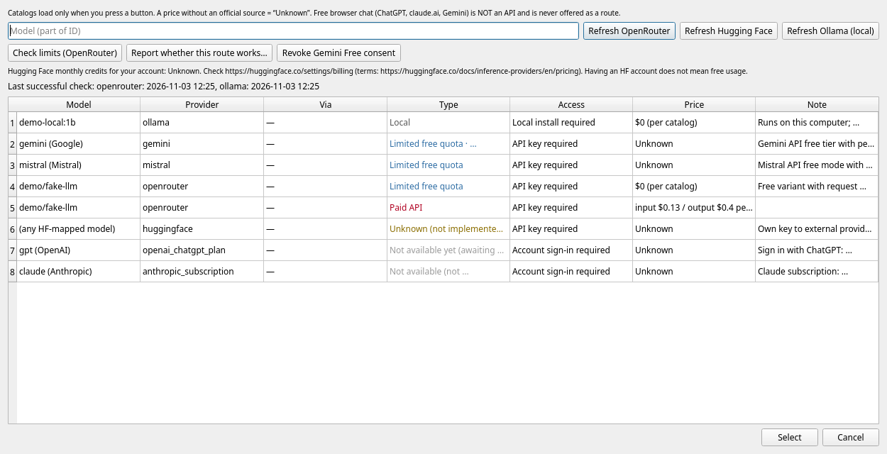
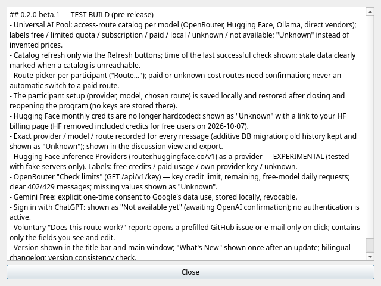
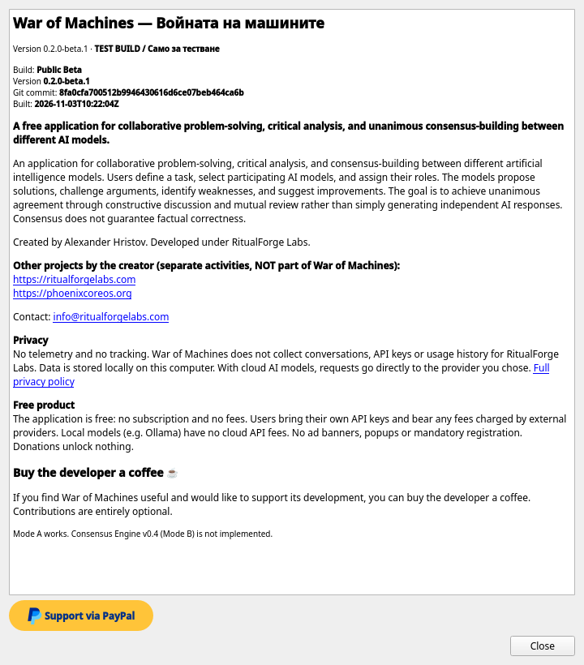
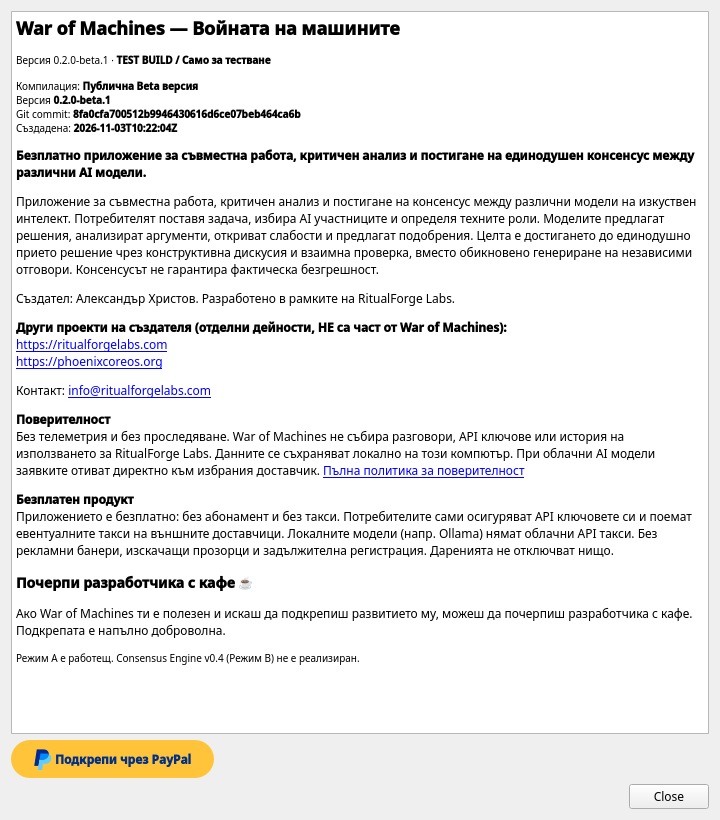

<p align="center">
  
</p>

<p align="center"><b>PRIVACY IS A PRINCIPLE, NOT AN OPTIONAL FEATURE.</b></p>

<p align="center">War of Machines does not collect telemetry, user conversations, API keys, or usage history for RitualForge Labs. Application data is stored locally. When cloud AI models are used, selected requests are sent directly to the respective provider.</p>

<p align="center"><code>Local-first · No telemetry · No tracking · User-controlled data</code><br><a href="PRIVACY_EN.md">Privacy policy (EN)</a> · <a href="PRIVACY_BG.md">Политика за поверителност (BG)</a></p>

<p align="center"><b>English</b> · <a href="README_BG.md">Български</a></p>

<p align="center"><a href="https://github.com/PhoenixbgOrg/war-of-machines/releases/download/v0.2.0-beta.2/war-of-machines-0.2.0-beta.2-linux-x86_64.tar.gz"><b>⬇ DOWNLOAD FOR LINUX</b></a> · <a href="https://github.com/PhoenixbgOrg/war-of-machines/releases/download/v0.2.0-beta.2/war-of-machines-0.2.0-beta.2-windows-x64.zip"><b>⬇ DOWNLOAD FOR WINDOWS (experimental)</b></a> · <a href="https://github.com/PhoenixbgOrg/war-of-machines/releases/tag/v0.2.0-beta.2"><b>TRY THE TEST BUILD</b></a> · <a href="https://github.com/PhoenixbgOrg/war-of-machines/issues/new?template=bug_report.md"><b>REPORT BUG</b></a> · <a href="https://github.com/PhoenixbgOrg/war-of-machines/issues/new?template=feature_request.md"><b>REQUEST FEATURE</b></a></p>

# War of Machines

A free desktop application in which several AI models from different providers work on **one task as a team** — they propose, criticise and revise each other's answers in one shared discussion.

## Contents
- [What it is and why it was created](#what-it-is-and-why-it-was-created)
- [How it works](#how-it-works)
- [Agreement is not proof](#agreement-is-not-proof)
- [Free, your keys, your costs](#free-your-keys-your-costs)
- [Languages](#languages)
- [Providers and models](#providers-and-models)
- [Modes](#modes)
- [Verification status](#verification-status)
- [Download and install](#download-and-install)
- [Screenshots](#screenshots)
- [Feedback](#feedback)
- [Licensing](#licensing)

## What it is and why it was created

Asking one AI model gives you one point of view, including its blind spots. War of Machines was created to let several real models — for example from OpenAI, Anthropic and Google — look at the same question together, point out each other's mistakes and improve the result, while you watch every step.

## How it works

1. You write a task and choose which models take part.
2. **Proposal** — the models give their first answers.
3. **Critique** — each model reviews the others' answers and points out errors, gaps and weak arguments.
4. **Revision** — the models revise their answers using the critique.
5. You see the whole discussion and the final answers, and decide yourself.

All participants are real AI models called through their providers' official APIs with your own keys. The discussion is saved locally on your computer.

## Agreement is not proof

When several models agree, that is **not proof that the answer is factually correct**. Models can share the same wrong information or reinforce each other. Treat the result as a well-argued draft and verify important facts from reliable sources.

## Free, your keys, your costs

- The application is **free**, with **no ads**. Support for the project is **voluntary**.
- You use **your own API keys**. Any fees are charged **by your provider** to your account; War of Machines does not charge anything and does not see your billing.
- **No automatic paid requests:** model lists and conversations are requested only when you start them.
- API keys are stored in your **system keyring** (for example GNOME Keyring), not in plain-text files. There is no telemetry.

## Languages

- User interface in **English** and **Bulgarian**.
- A separate setting for the **language of the AI discussion**, so you can, for example, use a Bulgarian interface while the models discuss in English.

## Providers and models

Supported providers: **OpenAI**, **xAI**, **Anthropic**, **Google Gemini**, **Mistral**, **DeepSeek**, **OpenRouter**, and optionally **local Ollama** (runs on your machine, no key needed). The v0.2.0-beta.1 TEST BUILD adds **Hugging Face Inference Providers** (experimental) and per-model **access routes** (Universal AI Pool).

The **model catalog is dynamic**: available models are loaded from each provider when you ask, so new models appear without an application update.

## Modes

| Mode | Status |
|---|---|
| **Mode A — AI Team** (proposal → critique → revision) | ✅ Available |
| **Mode B — Consensus Engine v0.4** | ⏳ **Not implemented** — a planned idea only |

The application also contains a **SIMULATION** provider for trying the interface without keys. **The simulator is not real AI**: it produces placeholder text and its results are never presented as a consensus.

## Verification status

| Area | Status |
|---|---|
| Automated tests | **v0.2.0-beta.2 (TEST BUILD):** 181 passed / 2 skipped on Linux (Python 3.11, 3.12, 3.13 in CI) and 179 passed / 4 skipped on a Windows Server 2025 CI runner (Linux-only installer tests skipped), plus a 28/28 GUI smoke test and install/upgrade checks of the compiled Linux build. **v0.2.0-beta.1 (TEST BUILD):** 161 passed / 2 skipped, plus a 28/28 compiled GUI smoke test. **v0.1.1-beta:** 119 passed / 1 skipped on the release candidate (its release notes count 133 tests for the compiled build, including packaging checks). All offline, with fake local servers |
| Paid multi-model conversations with real cloud models | ✅ Manually verified by the owner (reported 2026-11-02, not automated) |
| Anthropic, Google Gemini, Mistral with real keys | ✅ Manually verified by the owner (reported 2026-11-02, not automated) |
| OpenAI model list with a real key | ✅ Verified by the owner (2026-10-30) |
| xAI model list with a real key | ✅ Verified by the owner (HTTP 403 until the account was funded) |
| GNOME Keyring storage | ✅ Verified by the owner |
| DeepSeek, OpenRouter with real keys | ❌ Not verified (tested only against a local fake server) |
| v0.2 routes: Hugging Face, OpenRouter "Check limits", OpenRouter chat | ❌ Not verified with real accounts (local fake servers only; experimental) |
| Windows x64 portable | ⚠️ Tested on Windows Server 2025/2022 CI runners only; Windows 11/10 pending |
| Other Linux distributions | ❌ Not verified |

Tested on Debian 13 XFCE.

## Quick start for beginners (TEST BUILD v0.2.0-beta.2, Linux)

1. Open the [v0.2.0-beta.2 release page](https://github.com/PhoenixbgOrg/war-of-machines/releases/tag/v0.2.0-beta.2) and download `war-of-machines-0.2.0-beta.2-linux-x86_64.tar.gz` and `SHA256SUMS` into the same folder. (The "Source code" archives on the release page are **not** install packages.)
2. Open a terminal in that folder and check the download: `sha256sum -c SHA256SUMS` must print `OK`.
3. Unpack and install (no root needed):
   ```bash
   tar xzf war-of-machines-0.2.0-beta.2-linux-x86_64.tar.gz
   cd war-of-machines-0.2.0-beta.2-linux-x86_64
   ./install.sh
   ```
4. Start it from the menu or with `war-of-machines`. Create the local owner account, then open **Providers and models** to add an API key and press **Refresh models**. Without keys you can still try Mode A with the built-in **simulator** (not real AI).
5. Installing over v0.2.0-beta.1 or v0.1.1-beta keeps your data and history.

**Windows x64 (EXPERIMENTAL / TEST BUILD):** [war-of-machines-0.2.0-beta.2-windows-x64.zip](https://github.com/PhoenixbgOrg/war-of-machines/releases/download/v0.2.0-beta.2/war-of-machines-0.2.0-beta.2-windows-x64.zip) · [SHA256SUMS-windows.txt](https://github.com/PhoenixbgOrg/war-of-machines/releases/download/v0.2.0-beta.2/SHA256SUMS-windows.txt)
SHA-256: `1ecaf8342b2822200964cad7f099543b4a352f13dce5b87f0084f6db1682ff45`

1. Check the download in PowerShell: `Get-FileHash .\war-of-machines-0.2.0-beta.2-windows-x64.zip -Algorithm SHA256` — the value must match the one above.
2. Extract the ZIP to a normal folder you own (e.g. Documents). It is portable: no installer, no admin rights needed.
3. Open the extracted folder and run `war-of-machines.exe`.

- Tested only on GitHub Actions runners: Windows Server 2025 (10.0.26100) and Windows Server 2022 (10.0.20348), x64. **Windows 11 and Windows 10 (22H2): manual testing pending**; Windows 10 is past Microsoft's standard end of support. Compatibility reports are welcome.
- The program is not code-signed, so Windows SmartScreen may show "Windows protected your PC". Check the SHA-256 first; choosing "More info → Run anyway" is your own decision, only if you trust this source.
- Your data is stored in `%LOCALAPPDATA%\WarOfMachines\data`. Deleting the program folder does not delete your data.
- Qt / PySide6 are included as separate, unmodified LGPL-3.0 DLLs that can be replaced; see `THIRD_PARTY_NOTICES.md` inside the ZIP.
- Per-row Duplicate / Remove / Move up buttons were checked only in a compiled test harness on Windows, not by clicking in the real window.

### Known bugs and limitations (v0.2.0-beta.2)
- Hugging Face, OpenRouter, DeepSeek and the custom OpenAI-compatible endpoint were tested only against local fake servers (experimental).
- Mode B / Consensus Engine v0.4 is not implemented. The simulator is not real AI.
- Sign in with ChatGPT is not available.
- Tested on Debian 13 XFCE only; other distributions, Wayland and HiDPI are untested.
- Please report anything else with **[REPORT BUG](https://github.com/PhoenixbgOrg/war-of-machines/issues/new?template=bug_report.md)** or a **[compatibility test](https://github.com/PhoenixbgOrg/war-of-machines/issues/new?template=compatibility_test.md)**.

## Download and install

| Release | Label | Download |
|---|---|---|
| **v0.1.1-beta** | Public beta (pre-release) — the current recommended build | [Releases → v0.1.1-beta](../../releases/tag/v0.1.1-beta): `war-of-machines-0.1.1-beta-linux-x86_64.tar.gz` + `SHA256SUMS` |
| **v0.2.0-beta.2** | **TEST BUILD / Само за тестване** (pre-release) — Bugfix & UX Improvements | [Releases → v0.2.0-beta.2](../../releases/tag/v0.2.0-beta.2): `war-of-machines-0.2.0-beta.2-linux-x86_64.tar.gz` + `SHA256SUMS` |
| **v0.2.0-beta.1** | **TEST BUILD / Само за тестване** (pre-release, for testers) — Universal AI Pool: access routes per model | [Releases → v0.2.0-beta.1](../../releases/tag/v0.2.0-beta.1): `war-of-machines-0.2.0-beta.1-linux-x86_64.tar.gz` + `SHA256SUMS` |

The TEST BUILD adds new routes that are **experimental**: Hugging Face, OpenRouter "Check limits", DeepSeek and OpenRouter chat were tested only against local fake servers. Sign in with ChatGPT is not available; Mode B is not implemented. Installing v0.2.0-beta.1 over v0.1.1-beta keeps your history (old records show the route as "Unknown"). See [CHANGELOG.md](CHANGELOG.md) / [CHANGELOG_BG.md](CHANGELOG_BG.md).


v0.1.1-beta is a **standalone compiled program for Linux x86_64**.
- It needs no Python and downloads nothing during installation.
- It installs per user, with no root.
- It is built for **Debian 13 (XFCE)**.
- **Not tested, feedback from testers expected:** other distributions, Wayland and HiDPI.

**Prerequisites (Debian 13).** These system libraries are usually already installed. `install.sh` checks for them and tells you if any are missing:

```bash
sudo apt install libxcb-cursor0 libxkbcommon-x11-0 libxcb-icccm4 libxcb-image0 libxcb-keysyms1 libxcb-randr0 \
     libxcb-render-util0 libxcb-shape0 libxcb-xkb1 libxcb-xfixes0 libx11-xcb1 libegl1 libgl1 libdbus-1-3 libfontconfig1 libglib2.0-0t64
```

A Secret Service keyring (for example `gnome-keyring` or KeePassXC) is needed to save API keys.

```bash
sha256sum -c SHA256SUMS
tar xzf war-of-machines-0.1.1-beta-linux-x86_64.tar.gz
cd war-of-machines-0.1.1-beta-linux-x86_64
./install.sh
war-of-machines
```

For the TEST BUILD, use the same steps with `war-of-machines-0.2.0-beta.1-linux-x86_64` (its own `SHA256SUMS`).

- **Where it installs.** `install.sh` installs into `~/.local/share/war-of-machines` and adds a menu entry. It moves an older install aside and never deletes your data.
- **Uninstall.** `./uninstall.sh` removes the program and keeps your data.
- **Source code archives.** The "Source code" archives that GitHub adds automatically to every release contain only this project page, not the application.

## Screenshots

All screenshots use **synthetic demo data** and fake keys.

| | |
|---|---|
|  |  |
| Main window (EN) | Main window (BG) |
|  |  |
| Providers (EN) | About (EN) |
|  | |
| Mode A result with the simulator (not real AI) | |
|  |  |
| TEST BUILD v0.2.0-beta.1: route picker (synthetic catalog) | TEST BUILD v0.2.0-beta.1: What's New |
|  |  |
| TEST BUILD v0.2.0-beta.1: About (EN) | TEST BUILD v0.2.0-beta.1: About (BG) |

## Feedback

Feedback is voluntary. Report bugs or ideas in [GitHub Issues](../../issues) or by email to info@ritualforgelabs.com. Please **do not include API keys, passwords or private conversations**. The application sends nothing automatically. If you attach a log, the application already hides keys and home-directory paths in it, but please check it yourself first. GitHub and your email provider process what you send under their own terms.

## Licensing

War of Machines is **freeware** under the [War of Machines Freeware License v1.0](LICENSE) (Bulgarian and English text; the Bulgarian text prevails). The licence applies to the released program packages. This repository contains only the project page; the application source code is not published. See also [LICENSING.md](LICENSING.md), [PRIVACY_EN.md](PRIVACY_EN.md), [THIRD_PARTY_NOTICES.md](THIRD_PARTY_NOTICES.md) and the [name and image notice](docs/assets/promo/NOTICE.md).


Security issues: see [SECURITY.md](SECURITY.md). Changes: [CHANGELOG.md](CHANGELOG.md).

---

<p align="center">
Created by <b>Alexander Hristov</b> · Developed under <b>RitualForge Labs</b><br>
<a href="https://ritualforgelabs.com">ritualforgelabs.com</a> · <a href="https://phoenixcoreos.org">phoenixcoreos.org</a> · <a href="mailto:info@ritualforgelabs.com">info@ritualforgelabs.com</a>
</p>

<p align="center">
War of Machines is free and will stay without ads. If it is useful to you, you can support its development voluntarily via PayPal.Me: <a href="https://paypal.me/Hristov375">paypal.me/Hristov375</a>. The <i>Support via PayPal</i> button in the application's About window opens the same page in your browser. Support is never required and does not unlock features.
</p>

<p align="center">© 2026 Alexander Hristov / RitualForge Labs</p>
