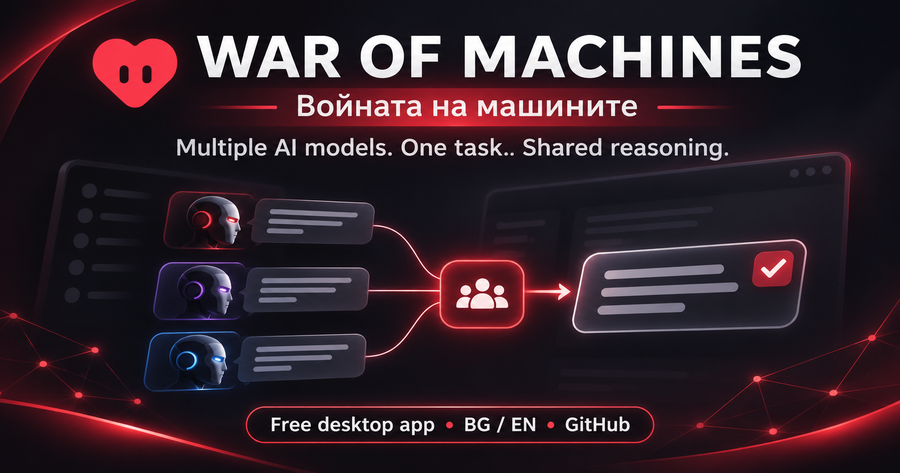
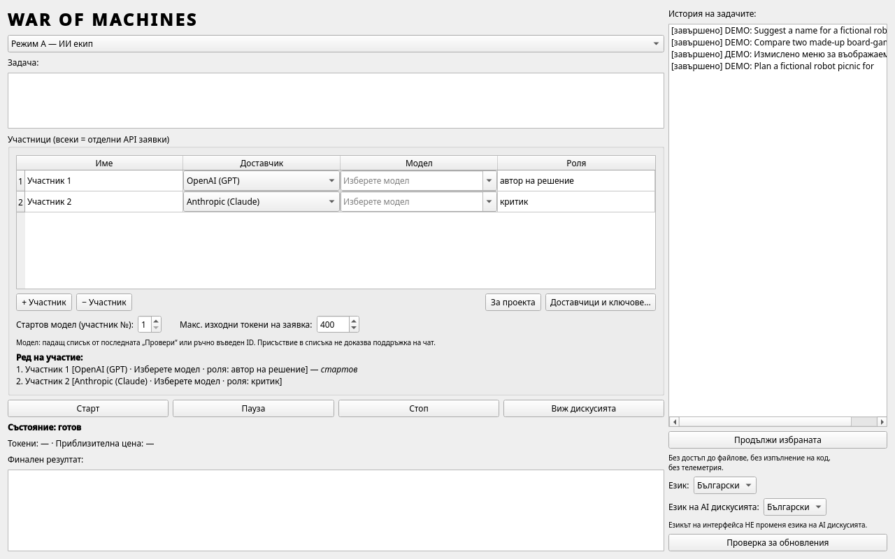
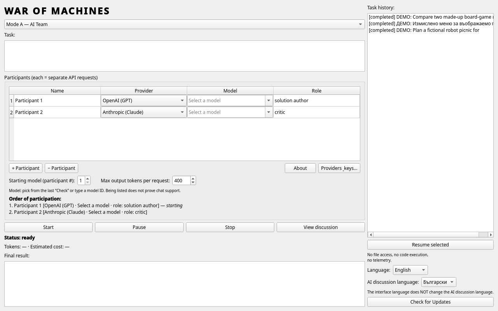
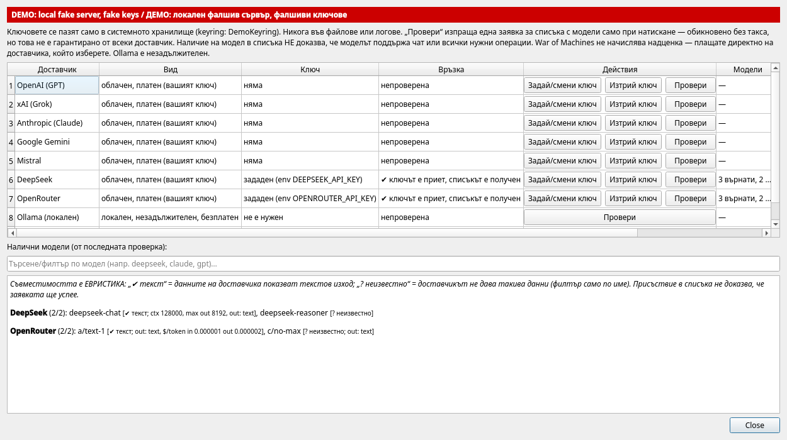
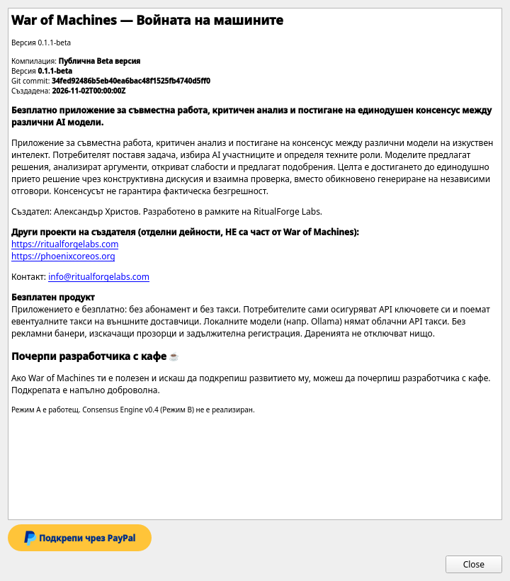
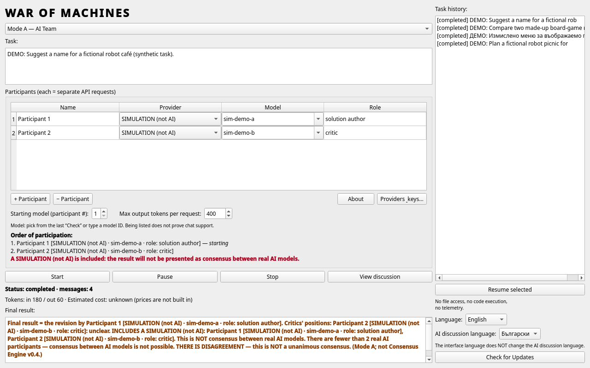
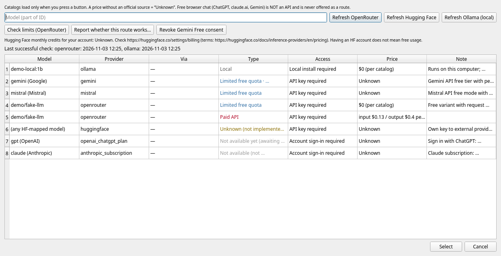
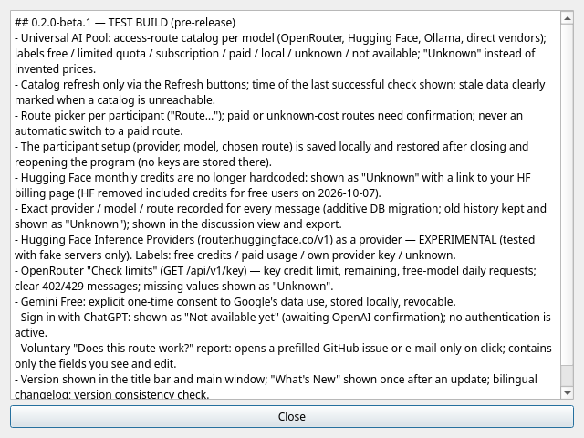
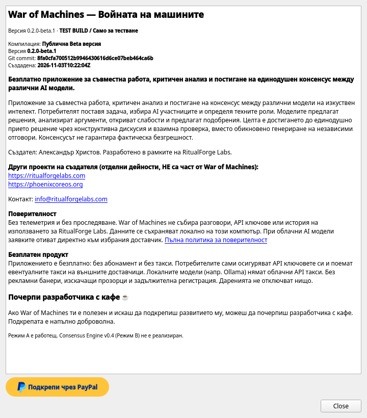
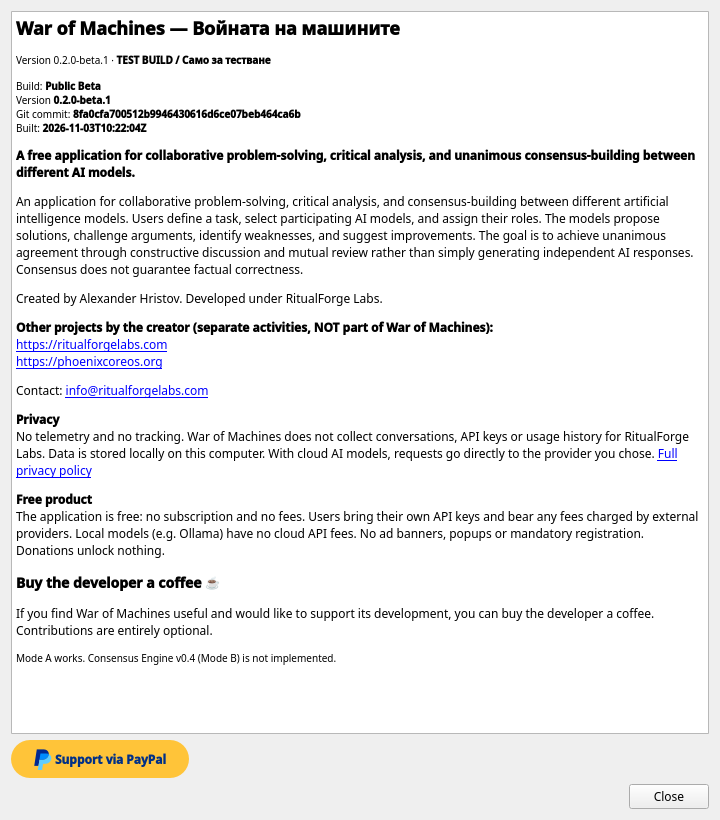

<p align="center">
  
</p>

<p align="center"><b>ПОВЕРИТЕЛНОСТТА Е ПРИНЦИП, НЕ ДОПЪЛНИТЕЛНА ФУНКЦИЯ.</b></p>

<p align="center">War of Machines не събира телеметрия, потребителски разговори, API ключове или история на използването за RitualForge Labs. Данните на приложението се съхраняват локално. При използване на облачни AI модели избраните заявки се изпращат директно към съответния доставчик.</p>

<p align="center"><code>Local-first · No telemetry · No tracking · User-controlled data</code><br><a href="PRIVACY_BG.md">Политика за поверителност (BG)</a> · <a href="PRIVACY_EN.md">Privacy policy (EN)</a></p>

<p align="center"><a href="README.md">English</a> · <b>Български</b></p>

<p align="center"><a href="https://github.com/PhoenixbgOrg/war-of-machines/releases/download/v0.2.0-beta.2/war-of-machines-0.2.0-beta.2-linux-x86_64.tar.gz"><b>⬇ ИЗТЕГЛИ ЗА LINUX</b></a> · <b>ИЗТЕГЛИ ЗА WINDOWS</b>: все още не е налично · <a href="https://github.com/PhoenixbgOrg/war-of-machines/releases/tag/v0.2.0-beta.2"><b>ИЗПРОБВАЙ ТЕСТОВАТА ВЕРСИЯ</b></a> · <a href="https://github.com/PhoenixbgOrg/war-of-machines/issues/new?template=bug_report.md"><b>ДОКЛАДВАЙ БЪГ</b></a> · <a href="https://github.com/PhoenixbgOrg/war-of-machines/issues/new?template=feature_request.md"><b>ПРЕДЛОЖИ ПОДОБРЕНИЕ</b></a></p>

# War of Machines — Войната на машините

Безплатно настолно приложение, в което няколко ИИ модела от различни доставчици работят по **една задача като екип** — предлагат, критикуват и преработват отговорите си в обща дискусия.

## Съдържание
- [Какво е и защо е създадено](#какво-е-и-защо-е-създадено)
- [Как работи](#как-работи)
- [Съгласието не е доказателство](#съгласието-не-е-доказателство)
- [Безплатно, вашите ключове, вашите разходи](#безплатно-вашите-ключове-вашите-разходи)
- [Езици](#езици)
- [Доставчици и модели](#доставчици-и-модели)
- [Режими](#режими)
- [Състояние на проверките](#състояние-на-проверките)
- [Изтегляне и инсталиране](#изтегляне-и-инсталиране)
- [Екранни снимки](#екранни-снимки)
- [Обратна връзка](#обратна-връзка)
- [Лиценз](#лиценз)

## Какво е и защо е създадено

Когато питате един ИИ модел, получавате една гледна точка — заедно с нейните слепи петна. War of Machines е създадено, за да могат няколко реални модела — например от OpenAI, Anthropic и Google — да разгледат един и същ въпрос заедно, да посочат грешките си и да подобрят резултата, докато вие следите всяка стъпка.

## Как работи

1. Пишете задача и избирате кои модели участват.
2. **Предложение** — моделите дават първите си отговори.
3. **Критика** — всеки модел преглежда отговорите на другите и посочва грешки, пропуски и слаби аргументи.
4. **Преработка** — моделите преработват отговорите си според критиката.
5. Виждате цялата дискусия и крайните отговори и решавате сами.

Всички участници са реални ИИ модели, извиквани през официалните API на доставчиците с вашите ключове. Дискусията се пази локално на вашия компютър.

## Съгласието не е доказателство

Когато няколко модела са съгласни, това **не доказва, че отговорът е фактически верен**. Моделите могат да споделят една и съща грешна информация или да се подкрепят взаимно. Приемайте резултата като добре аргументирана чернова и проверявайте важните факти от надеждни източници.

## Безплатно, вашите ключове, вашите разходи

- Приложението е **безплатно** и **без реклами**. Подкрепата за проекта е **доброволна**.
- Използвате **собствени API ключове**. Евентуалните такси се начисляват **от вашия доставчик** по вашата сметка; War of Machines не таксува нищо и не вижда плащанията ви.
- **Без автоматични платени заявки:** списъците с модели и разговорите се изпращат само когато вие ги стартирате.
- API ключовете се пазят в **системния keyring** (например GNOME Keyring), а не в текстови файлове. Няма телеметрия.

## Езици

- Потребителски интерфейс на **български** и **английски**.
- Отделна настройка за **езика на AI дискусията** — например интерфейс на български, а моделите да дискутират на английски.

## Доставчици и модели

Поддържани доставчици: **OpenAI**, **xAI**, **Anthropic**, **Google Gemini**, **Mistral**, **DeepSeek**, **OpenRouter** и по желание **локален Ollama** (работи на вашия компютър, без ключ). Тестовата компилация v0.2.0-beta.1 добавя **Hugging Face Inference Providers** (експериментално) и **маршрути за достъп** за всеки модел (Universal AI Pool).

**Каталогът с модели е динамичен:** наличните модели се зареждат от всеки доставчик при поискване, така че новите модели се появяват без обновяване на приложението.

## Режими

| Режим | Състояние |
|---|---|
| **Режим A — ИИ екип** (предложение → критика → преработка) | ✅ Наличен |
| **Режим B — Consensus Engine v0.4** | ⏳ **Не е реализиран** — само планирана идея |

Приложението има и доставчик **СИМУЛАЦИЯ**, за да пробвате интерфейса без ключове. **Симулаторът не е реален ИИ**: той създава примерен текст и резултатите му никога не се представят като консенсус.

## Състояние на проверките

| Област | Състояние |
|---|---|
| Автоматизирани тестове | **v0.2.0-beta.2 (тестова компилация):** 181 успешни / 2 пропуснати на Linux (Python 3.11, 3.12, 3.13 в CI) и 179 успешни / 4 пропуснати на CI машина с Windows Server 2025 (пропуснати са тестовете само за Linux инсталатора), плюс GUI смоук тест 28/28 и проверки за инсталиране/надграждане на компилираната версия за Linux. **v0.2.0-beta.1 (тестова компилация):** 161 успешни / 2 пропуснати, плюс компилиран GUI тест 28/28. **v0.1.1-beta:** 119 успешни / 1 пропуснат на кандидата (бележките към изданието посочват 133 теста за компилацията, включително проверки на пакета). Всички офлайн, с фалшиви локални сървъри |
| Платени разговори между няколко реални облачни модела | ✅ Проверено ръчно от собственика (съобщено на 2026-11-02, не е автоматизирано) |
| Anthropic, Google Gemini, Mistral с реални ключове | ✅ Проверено ръчно от собственика (съобщено на 2026-11-02, не е автоматизирано) |
| Списък с модели на OpenAI с реален ключ | ✅ Проверено от собственика (2026-10-30) |
| Списък с модели на xAI с реален ключ | ✅ Проверено от собственика (HTTP 403, докато акаунтът не беше зареден) |
| Съхранение в GNOME Keyring | ✅ Проверено от собственика |
| DeepSeek, OpenRouter с реални ключове | ❌ Не е проверено (само с локален фалшив сървър) |
| Маршрути от v0.2: Hugging Face, „Провери лимитите“ на OpenRouter, чат през OpenRouter | ❌ Не е проверено с реални акаунти (само с локални фалшиви сървъри; експериментално) |
| Windows, други Linux дистрибуции | ❌ Не е проверено |

Tested on Debian 13 XFCE. (Тествано на Debian 13 XFCE.)

## Бърз старт за начинаещи (ТЕСТОВА КОМПИЛАЦИЯ v0.2.0-beta.2, Linux)

1. Отворете [страницата на v0.2.0-beta.2](https://github.com/PhoenixbgOrg/war-of-machines/releases/tag/v0.2.0-beta.2) и изтеглете `war-of-machines-0.2.0-beta.2-linux-x86_64.tar.gz` и `SHA256SUMS` в една папка. (Архивите „Source code“ на страницата **не са** инсталационни пакети.)
2. Отворете терминал в тази папка и проверете файла: `sha256sum -c SHA256SUMS` трябва да изпише `OK`.
3. Разархивирайте и инсталирайте (без root):
   ```bash
   tar xzf war-of-machines-0.2.0-beta.2-linux-x86_64.tar.gz
   cd war-of-machines-0.2.0-beta.2-linux-x86_64
   ./install.sh
   ```
4. Стартирайте от менюто или с `war-of-machines`. Създайте локалния акаунт на собственика, после отворете **Доставчици и модели**, добавете API ключ и натиснете **Обнови моделите**. Без ключове можете да пробвате Режим A с вградения **симулатор** (не е истински ИИ).
5. Инсталирането върху v0.2.0-beta.1 или v0.1.1-beta запазва данните и историята.

**Windows:** все още не е налично (планирани: Windows 11 x64 и Windows 10 22H2 x64; Windows 10 е извън стандартната поддръжка на Microsoft — тестовете са добре дошли, но не е проверено). Тества се преносима версия за Windows; когато бъде публикувана, Windows може да покаже предупреждение SmartScreen („Windows защити компютъра ви“), защото програмата не е подписана — първо проверете SHA-256 и само ако съвпада изберете „Повече информация → Изпълни въпреки това“.

### Известни бъгове и ограничения (v0.2.0-beta.2)
- Hugging Face, OpenRouter, DeepSeek и собственият OpenAI-съвместим адрес са тествани само с локални фалшиви сървъри (експериментално).
- Режим B / Consensus Engine v0.4 не е реализиран. Симулаторът не е истински ИИ.
- Вход с ChatGPT не е наличен.
- Тествано само на Debian 13 XFCE; други дистрибуции, Wayland и HiDPI не са тествани.
- Съобщете за всичко друго чрез **[ДОКЛАДВАЙ БЪГ](https://github.com/PhoenixbgOrg/war-of-machines/issues/new?template=bug_report.md)** или **[тест за съвместимост](https://github.com/PhoenixbgOrg/war-of-machines/issues/new?template=compatibility_test.md)**.

## Изтегляне и инсталиране

| Издание | Етикет | Изтегляне |
|---|---|---|
| **v0.1.1-beta** | Публична бета (предварително издание) — препоръчваната текуща версия | [Releases → v0.1.1-beta](../../releases/tag/v0.1.1-beta): `war-of-machines-0.1.1-beta-linux-x86_64.tar.gz` + `SHA256SUMS` |
| **v0.2.0-beta.2** | **TEST BUILD / Само за тестване** (предварително издание) — Поправки и подобрения на интерфейса | [Releases → v0.2.0-beta.2](../../releases/tag/v0.2.0-beta.2): `war-of-machines-0.2.0-beta.2-linux-x86_64.tar.gz` + `SHA256SUMS` |
| **v0.2.0-beta.1** | **TEST BUILD / Само за тестване** (предварително издание, за тестери) — Universal AI Pool: маршрути за достъп за всеки модел | [Releases → v0.2.0-beta.1](../../releases/tag/v0.2.0-beta.1): `war-of-machines-0.2.0-beta.1-linux-x86_64.tar.gz` + `SHA256SUMS` |

Тестовата компилация добавя нови маршрути, които са **експериментални**: Hugging Face, „Провери лимитите“ на OpenRouter, DeepSeek и чат през OpenRouter са тествани само с локални фалшиви сървъри. Sign in with ChatGPT не е наличен; режим B не е реализиран. Инсталирането на v0.2.0-beta.1 върху v0.1.1-beta запазва историята (старите записи показват маршрута като „Неизвестно“). Вижте [CHANGELOG_BG.md](CHANGELOG_BG.md) / [CHANGELOG.md](CHANGELOG.md).


v0.1.1-beta е **самостоятелна компилирана програма за Linux x86_64**.
- Не изисква Python и не изтегля нищо при инсталиране.
- Инсталира се за потребителя, без root.
- Предназначена е за **Debian 13 (XFCE)**.
- **Не е тествано, очаква се обратна връзка от тестери:** други дистрибуции, Wayland и HiDPI.

**Предварителни изисквания (Debian 13).** Тези системни библиотеки обикновено вече са налични. `install.sh` ги проверява и съобщава, ако липсва някоя:

```bash
sudo apt install libxcb-cursor0 libxkbcommon-x11-0 libxcb-icccm4 libxcb-image0 libxcb-keysyms1 libxcb-randr0 \
     libxcb-render-util0 libxcb-shape0 libxcb-xkb1 libxcb-xfixes0 libx11-xcb1 libegl1 libgl1 libdbus-1-3 libfontconfig1 libglib2.0-0t64
```

За запазване на API ключове е нужен keyring със Secret Service (например `gnome-keyring` или KeePassXC).

```bash
sha256sum -c SHA256SUMS
tar xzf war-of-machines-0.1.1-beta-linux-x86_64.tar.gz
cd war-of-machines-0.1.1-beta-linux-x86_64
./install.sh
war-of-machines
```

За тестовата компилация използвайте същите стъпки с `war-of-machines-0.2.0-beta.1-linux-x86_64` (със собствен `SHA256SUMS`).

- **Къде се инсталира.** `install.sh` инсталира в `~/.local/share/war-of-machines` и добавя запис в менюто. Старата инсталация се премества настрана и данните никога не се изтриват.
- **Премахване.** `./uninstall.sh` премахва програмата и запазва данните.
- **Архиви „Source code“.** Архивите „Source code“, които GitHub добавя автоматично към всяко издание, съдържат само тази страница, а не приложението.

## Екранни снимки

Всички снимки са със **синтетични демо данни** и фалшиви ключове.

| | |
|---|---|
|  |  |
| Главен прозорец (BG) | Главен прозорец (EN) |
|  |  |
| Доставчици (BG) | За проекта (BG) |
|  | |
| Резултат от режим A със симулатора (не е реален ИИ) | |
|  |  |
| TEST BUILD v0.2.0-beta.1: избор на маршрут (синтетичен каталог) | TEST BUILD v0.2.0-beta.1: „Какво е новото“ |
|  |  |
| TEST BUILD v0.2.0-beta.1: За проекта (BG) | TEST BUILD v0.2.0-beta.1: За проекта (EN) |

## Обратна връзка

Обратната връзка е доброволна. Съобщавайте за грешки или идеи в [GitHub Issues](../../issues) или по имейл на info@ritualforgelabs.com. Моля, **не включвайте API ключове, пароли или лични разговори**. Приложението не изпраща нищо автоматично. Ако прикачите лог, приложението вече скрива ключовете и пътищата до домашната папка в него, но го проверете и сами. GitHub и вашият имейл доставчик обработват изпратеното по своите условия.

## Лиценз

War of Machines е **freeware** по [War of Machines Freeware License v1.0](LICENSE) (български и английски текст; българският има предимство). Лицензът се прилага за публикуваните пакети на програмата. Това хранилище съдържа само страницата на проекта; изходният код на приложението не се публикува. Вижте също [LICENSING.md](LICENSING.md), [PRIVACY_BG.md](PRIVACY_BG.md), [THIRD_PARTY_NOTICES.md](THIRD_PARTY_NOTICES.md) и [бележката за името и изображенията](docs/assets/promo/NOTICE.md).


Сигурност: [SECURITY.md](SECURITY.md). Промени: [CHANGELOG.md](CHANGELOG.md).

---

<p align="center">
Създадено от <b>Александър Христов</b> · Разработено под <b>RitualForge Labs</b><br>
<a href="https://ritualforgelabs.com">ritualforgelabs.com</a> · <a href="https://phoenixcoreos.org">phoenixcoreos.org</a> · <a href="mailto:info@ritualforgelabs.com">info@ritualforgelabs.com</a>
</p>

<p align="center">
War of Machines е безплатно и ще остане без реклами. Ако ви е полезно, можете доброволно да подкрепите разработката чрез PayPal.Me: <a href="https://paypal.me/Hristov375">paypal.me/Hristov375</a>. Бутонът <i>„Подкрепи чрез PayPal“</i> в прозореца „За проекта“ отваря същата страница в браузъра. Подкрепата никога не е задължителна и не отключва функции.
</p>

<p align="center">© 2026 Александър Христов / RitualForge Labs</p>
